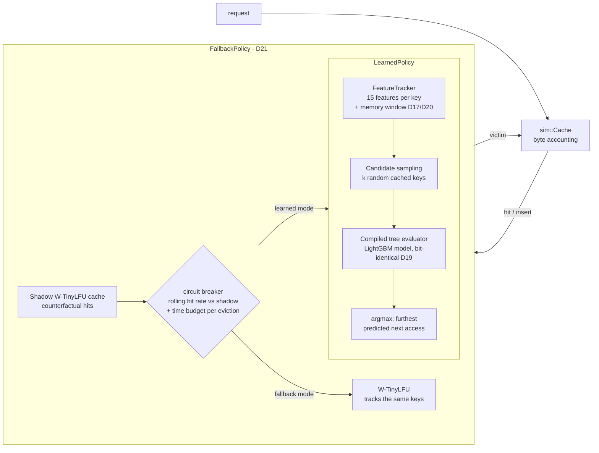
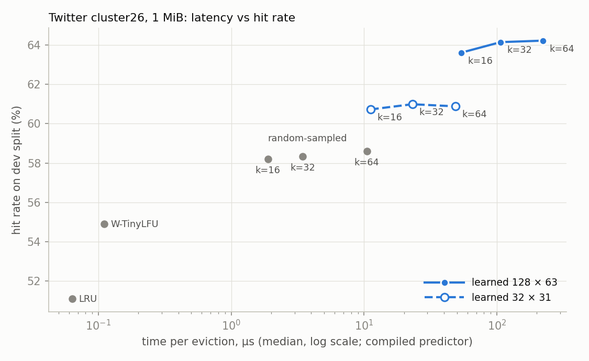
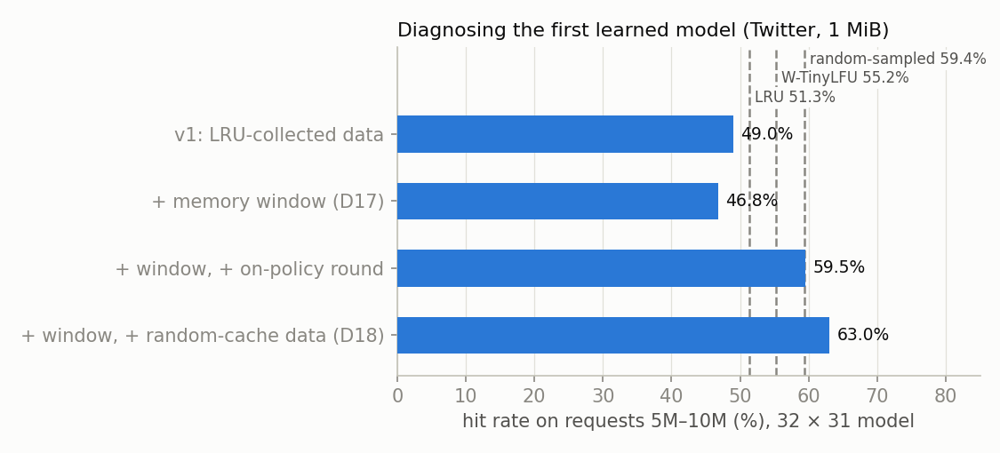

# Learned Cache Eviction

A cache eviction policy that **predicts which objects won't be needed soon** with a gradient-boosted
tree model, evicts those first, and **falls back to W-TinyLFU on its own** when the model loses or
runs over its time budget. It is written in C++20, benchmarked against LRU, LFU, ARC, W-TinyLFU and
the offline optimum (Belady) on real production traces, and validated exactly against
[libCacheSim](https://github.com/1a1a11a/libCacheSim).

**Headline (measured, held-out test split):** on the Twitter cluster26 trace with a 1 MiB cache,
the learned policy hits **68.08%** of requests vs **55.58%** for W-TinyLFU and 81.97% for Belady,
closing 47% of the gap to the optimum. It is **not** a win everywhere (see the table); the
fallback guard limits the damage where it loses.

> Status: milestones 1–4 of 7 are done (simulator, classic policies, learned policy, fallback).
> The network server, web dashboard, Docker setup and CI are not built yet; see
> [Project status](#project-status).

## Architecture



| stage | what it does | code |
|---|---|---|
| **FeatureTracker** | Per-key history: size, age, last 8 gaps between accesses, count, 4 exponentially decayed counters. Keeps history for recently evicted keys (memory window), sized as a multiple of the cache's object count; ages and gaps optionally normalized by it. | `ml/feature_tracker.*` |
| **Candidate sampling** | On each eviction, sample k cached keys uniformly (O(1) via a dense key array with swap-remove), as in Learning Relaxed Belady (Song et al., NSDI '20). | `policy/learned.*` |
| **Compiled tree evaluator** | Reads LightGBM's text model and evaluates it without LightGBM: flat 24-byte nodes, branch-free steps, 8 rows walked through each tree together. Bit-identical to LightGBM's scores; 1.8–2.5× faster per eviction. | `ml/tree_ensemble.*` |
| **Fallback guardrail** | Learned policy and W-TinyLFU both track the cache; a shadow W-TinyLFU gives the counterfactual. Switches to W-TinyLFU when the model is behind over a rolling window or exceeds its per-eviction time budget, and retries after a cooldown. | `policy/fallback.*` |

Training is offline: `lcache-export` replays a trace through a *collector* (the same sampling and
feature code, so training and inference features can't diverge) and writes one row per eviction
candidate with its true distance to the next access; `tools/train.py` fits a LightGBM regressor
on `log1p(distance)`.

## Results

All hit rates are on **held-out test data** that was never used for training or choosing
settings. Twitter cluster26 (first 10M requests): train 0–5M, dev 5M–7.5M, test 7.5M–10M.
cloudPhysicsIO (113,872 block I/O requests): train first 50%, dev next 25%, test last 25%.
Learned = 32 × 31-tree model, k = 64, window 4 × cached objects with normalized features (D20);
Guarded = the same inside the fallback guard with default settings (D21), no time budget.

| trace, cache size | LRU | W-TinyLFU | Learned | Guarded | Belady |
|---|---|---|---|---|---|
| Twitter, 512 KiB | **49.57%** | 49.11% | 44.40% | 48.77% | 64.42% |
| Twitter, 1 MiB | 51.57% | 55.58% | **65.28%** | 63.21% | 81.97% |
| Twitter, 4 MiB | **91.94%** | 82.11% | 90.73% | 91.81% | 92.38% |
| cloudPhysicsIO, 64 MiB | 13.88% | **17.43%** | 17.37% | 15.69% | 22.09% |
| cloudPhysicsIO, 256 MiB | 20.80% | **29.69%** | 29.26% | 16.69% | 39.00% |
| cloudPhysicsIO, 1 GiB | 40.23% | **65.41%** | 45.49% | 61.91% | 72.94% |

Best non-oracle policy per row in bold. With the larger 128 × 63-tree model, Twitter 1 MiB reaches
**68.08%** (the headline). Full tables, per-step history and every reproduction command:
[`docs/m3-results.md`](docs/m3-results.md), [`docs/m4-results.md`](docs/m4-results.md).

**How to read it honestly:**
- The learned policy wins clearly where it was developed (Twitter 1 MiB: +9.70 pp over
  W-TinyLFU) and loses where the model has little signal (Twitter 512 KiB, where it is weak even
  on its own validation data) or little training data (cloudPhysicsIO has 88× fewer requests).
- The guard turns the worst losses into small ones (Twitter 512 KiB: −4.71 → −0.34 pp vs
  W-TinyLFU; cloudPhysicsIO 1 GiB: −19.92 → −3.50 pp) and keeps most of the win at Twitter 1 MiB.
- **It fails on cloudPhysicsIO 64 / 256 MiB**, ending below both policies. Diagnosed: the model does
  badly on a cache W-TinyLFU shaped, a state its training data never contained (open problem).

### Latency per eviction

`bench/eviction_bench` (Google Benchmark, median of 5, i7-12700H): one `evict()` on a warmed
1 MiB Twitter cache.

| policy | k = 16 | k = 64 |
|---|---|---|
| LRU / W-TinyLFU | 0.06 / 0.11 µs | |
| learned 32 × 31, LightGBM library | 15.39 µs | 87.44 µs |
| learned 32 × 31, compiled evaluator | **11.23 µs** | **49.02 µs** |
| learned 128 × 63, compiled evaluator | 53.82 µs | 222.60 µs |

k = 16 loses at most 0.62 pp of hit rate vs k = 64 (dev split). The guard's own overhead is within
measurement noise.

<p align="center">
  
</p>

## Systems and ML insights

Each item is a decision record in [`docs/decisions.md`](docs/decisions.md) with the measurements
behind it.

**1. Feature amnesia: keep history for evicted keys (D17).** The first version dropped a key's
history when it was evicted. Measured: 83.5% of training candidates had a shorter history than
the trace shows, and 92.1% of candidates with no gap history had been requested before; only 7.9%
were new. A bounded memory window of evicted keys' histories cut "no history" from 38.5% to 3.7%
of candidates and doubled offline accuracy, **but on its own didn't improve the live hit rate**,
which led to the next finding.

**2. Distribution shift: train on a random-eviction cache too (D18).** The first model scored
49.05%, below *random eviction* (59.41%), despite picking better victims than random offline.
Cause: training data came from an LRU-driven cache, where no key gets older than ~13.5k requests.
Once the model ran the cache, keys never requested again sat there up to 4.8M requests old;
beyond the training range the trees' prediction is flat, so the model couldn't tell they were
dead. Adding data from a *random*-eviction cache, which keeps keys around much longer, fixed this
in one step (63.05%), better than iterated on-policy retraining (61.20% after two rounds).

**3. A compiled tree evaluator, bit-identical to LightGBM (D19).** With LightGBM's predictor an
eviction cost 87 µs at k = 64 (548 µs for the big model), versus 0.11 µs for W-TinyLFU. The evaluator stores
every tree in one flat array of 24-byte nodes and reproduces LightGBM's missing-value rules
exactly. The biggest single gain came from **removing branches**: the child is chosen by indexing
with the comparison result, because tree data makes every branch a coin flip for the predictor.
Scores are checked bit-for-bit against LightGBM on 20,000 rows for both models, and full replays
reproduce the same hit counts.

**4. Settings stored with the model (D20).** Three settings (window rule, window size,
normalization) must match between training and serving. `lcache-export` writes `<csv>.meta`,
`train.py` carries it to `<model>.meta`, and the simulator applies it and **refuses contradicting
flags**; normalized features have different column names, so a model can't load with the wrong
kind. The window scales with the cache's object count and ages are normalized by it; this helped
cloudPhysicsIO (+5.89 pp at 256 MiB) but is not a general fix.

**5. Shadow fallback with a circuit breaker (D21).** Both policies track the real cache, so a switch
takes effect at the very next eviction; a third, shadow W-TinyLFU provides the "what if"
hit count. Two problems only showed up on real traces: (a) right after switching back, the
learned policy trails while it reshapes a cache W-TinyLFU built, which caused 38–43 false trips
on Twitter 1 MiB; a grace period (chosen on dev) fixed most of it; (b) a budget breach count that
never expired turned 0.03–0.05% OS jitter into constant trips; breaches are now counted per 1,000
evictions. Tests force failures with a deliberately bad model (evicts the key needed *soonest*)
and a fake clock for latency spikes.

**What didn't help (measured on dev, kept out):** binary "beyond horizon" labels, clipped labels,
learning-to-rank, 5× more training rows, and scaling the window without normalizing.

<p align="center">
  
</p>

## Quickstart

Requirements: Linux (tested on WSL2 / Ubuntu 22.04 with GCC 11.4), CMake ≥ 3.22, Ninja,
`zstd`, Python 3.10 (training and plots only). Dependencies (GoogleTest, Google Benchmark,
CLI11, LightGBM 4.5.0) are fetched and pinned by hash at configure time.

```bash
# Build (presets: debug, release, asan = ASan+UBSan, tsan)
cmake --preset release && cmake --build --preset release

# Unit tests (211 tests; all pass under debug, asan and tsan)
cmake --preset debug && cmake --build --preset debug
ctest --preset debug --output-on-failure
# TSan on WSL2 needs ASLR off for the test process (docs/decisions.md D5):
setarch "$(uname -m)" -R ctest --preset tsan --output-on-failure

# Traces: cloudPhysicsIO (2.7 MB) and the first 10M requests of Twitter cluster26
# (downloads 784 MB, keeps a 240 MB checksum-pinned prefix)
tools/fetch_traces.sh

# Replay a trace: classic policies at several cache sizes (CSV to stdout)
build/release/apps/cachesim/cachesim -t data/cloudPhysicsIO.oracleGeneral.bin \
    -p lru,wtinylfu,belady -c 64MiB,256MiB,1GiB

# The learned and guarded policies with a committed model (its settings come from the .meta
# file next to it); score only requests 7.5M-10M of Twitter
build/release/apps/cachesim/cachesim -t data/twitter_cluster26_10M.oracleGeneral.bin \
    -p wtinylfu,learned,guarded -c 1MiB -w 7500000 \
    --model models/twitter26_1MiB_h10k_32x31.txt --sample-size 16 \
    --budget-us 100 --max-breaches 10

# Latency benchmark (needs the Twitter trace)
build/release/bench/eviction_bench
```

Train a model (see [`models/README.md`](models/README.md) for the exact commands behind the
committed models):

```bash
python3 -m venv .venv && .venv/bin/pip install -r tools/requirements.txt
T=data/twitter_cluster26_10M.oracleGeneral.bin
build/release/apps/export/lcache-export -t $T -c 1MiB -n 5000000 --every 50 --history 10000 -o lru.csv
build/release/apps/export/lcache-export -t $T -c 1MiB -n 5000000 --every 50 --history 10000 \
    --collector random -o random.csv
.venv/bin/python tools/train.py lru.csv random.csv --window 5000000 -o model.txt
```

## Repository layout

| path | contents |
|---|---|
| `trace/` | trace readers (libCacheSim oracleGeneral, CSV), next-access annotation |
| `policy/` | `EvictionPolicy` interface; LRU, LFU, ARC, W-TinyLFU, Belady, learned, guarded |
| `sketch/` | count-min sketch (W-TinyLFU) |
| `sim/` | byte-capacity cache and trace-driven simulator |
| `ml/` | feature tracker, predictors (compiled evaluator, LightGBM, oracle), training-data recorder, model metadata |
| `apps/` | `cachesim` (replay) and `lcache-export` (training data) |
| `bench/` | Google Benchmark latency suite |
| `tools/` | trace fetching, training, plotting, and the scripts that reproduce every result |
| `models/` | the two trained Twitter models with their `.meta` settings |
| `docs/` | design docs, results per milestone, decision log, figures |

## Correctness

- **Exact match with libCacheSim** for LRU (0.0000 pp difference in hits on every configuration;
  target was ≤ 0.5 pp), LFU, and ARC with unit sizes ([`docs/m1-validation.md`](docs/m1-validation.md),
  [`docs/m2-results.md`](docs/m2-results.md)).
- Belady equals an exhaustive-search optimum on 300 small random traces.
- The learned policy reduces exactly to LRU (age scores) and to Belady (oracle scores) when every
  cached key is a candidate.
- All tests pass under AddressSanitizer + UndefinedBehaviorSanitizer and ThreadSanitizer, with
  third-party code (including LightGBM) instrumented too.

## Project status

| milestone | status |
|---|---|
| 1. Simulator + LRU (validated vs libCacheSim) | done |
| 2. LFU, ARC, W-TinyLFU, Belady | done |
| 3. Learned policy (features, LightGBM, sampled eviction) | done |
| 4. Defensive fallback (shadow W-TinyLFU, time budget) | done |
| 5. Network server (sharded store, Redis RESP subset) | not started |
| 6. Web dashboard | not started |
| 7. Docker, CI, final write-up | README done; Docker and CI not started |

Open problems, measured and written up in [`docs/m4-results.md`](docs/m4-results.md): the learned
policy does badly on caches W-TinyLFU shaped; the model is weak at Twitter 512 KiB; the guard's
settings are request counts, too large for short traces.

## Further reading

- [`docs/decisions.md`](docs/decisions.md): every design decision and rejected alternative (D1–D21)
- [`docs/m3-design.md`](docs/m3-design.md): learned-policy design
- [`docs/m3-results.md`](docs/m3-results.md), [`docs/m4-results.md`](docs/m4-results.md): all measurements, with commands
