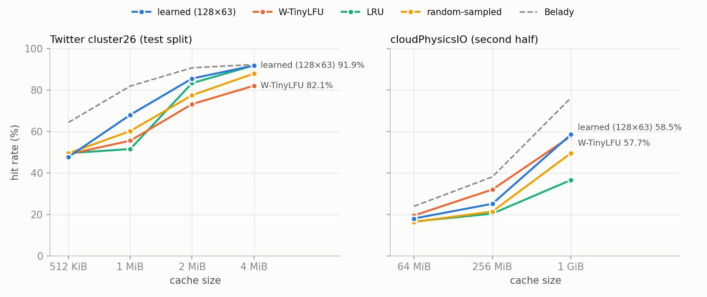

# Milestone 3 results

The summary is at the end ("M3 summary"); sections are in the order they were measured.

All numbers below were measured with the `release` build. Hit rates are over the **second half**
of the trace only: the first half warms the cache and will be the training set (decisions D10).
So these numbers are **not comparable with the M2 tables**, which count every request from a cold
cache.

## Step 4: the cost of sampling (no model yet)

`oracle-sampled` is `LearnedPolicy` with perfect predictions: at each eviction it samples 64
cached keys and evicts the one whose true next access is furthest away. It is the best any
learned model can do with this candidate sampling. `random-sampled` evicts a random sampled key.
Measured 2026-10-01 at commit `90aa58d`:

```
build/release/apps/cachesim/cachesim -t data/cloudPhysicsIO.oracleGeneral.bin \
    -p lru,wtinylfu,random-sampled,oracle-sampled,belady -c 64MiB,256MiB,1GiB -w 56936
build/release/apps/cachesim/cachesim -t data/cloudPhysicsIO.oracleGeneral.bin \
    -p lru,wtinylfu,random-sampled,oracle-sampled,belady -c 100,1000,10000 --ignore-size -w 56936
```

**Trace:** `cloudPhysicsIO.oracleGeneral.bin`, 113,872 requests; warmup 56,936; 56,936 requests
counted. Sample size 64, seed 1. Two runs gave byte-identical output.

### Hit rate, byte-sized cache

| policy | 64 MiB | 256 MiB | 1 GiB |
|---|---|---|---|
| LRU | 16.54% | 20.36% | 36.58% |
| random-sampled | 16.33% | 21.41% | 49.54% |
| W-TinyLFU | 19.45% | 32.01% | 57.71% |
| oracle-sampled | 23.59% | 37.57% | 76.02% |
| Belady | 23.90% | 38.12% | 76.24% |

### Hit rate, unit-size objects (`--ignore-size`)

| policy | 100 objects | 1,000 objects | 10,000 objects |
|---|---|---|---|
| LRU | 11.03% | 15.81% | 29.49% |
| random-sampled | 10.21% | 15.07% | 25.92% |
| W-TinyLFU | 12.21% | 17.59% | 38.90% |
| oracle-sampled | 16.45% | 22.78% | 52.75% |
| Belady | 16.52% | 22.91% | 53.64% |

### What this shows (this trace only)

- **Sampling 64 candidates costs at most 0.89 pp of hit rate** compared with full Belady (0.07 to
  0.89 pp across the six configurations). So almost all of the headroom is still available to a
  sampled learned policy.
- **The headroom over W-TinyLFU with perfect predictions is 4.13 to 18.31 pp** (4.13 / 5.57 /
  18.31 pp byte-sized; 4.24 / 5.19 / 13.85 pp unit-size). How much of it a LightGBM model recovers
  is what the next steps measure.
- `random-sampled` is below LRU in 4 of 6 configurations, but well above it at 1 GiB (49.54% vs
  36.58%).

## Steps 5–7: first model on Twitter cluster26 (first 10M requests)

Measured 2026-10-01 at commit `928cdb0`. Trace stats are in decisions D15. Warmup and training
window = the first 5,000,000 requests; hit rates are over the last 5,000,000.

```
build/release/apps/export/lcache-export -t data/twitter_cluster26_10M.oracleGeneral.bin \
    -c 1MiB -n 5000000 --every 50 -o build/m3/twitter_train_1MiB.csv
.venv/bin/python tools/train.py build/m3/twitter_train_1MiB.csv --window 5000000 \
    -o build/m3/twitter_1MiB_model.txt
build/release/apps/cachesim/cachesim -t data/twitter_cluster26_10M.oracleGeneral.bin \
    -p lru,wtinylfu,oracle-sampled,belady -c 1MiB,4MiB,16MiB -w 5000000
build/release/apps/cachesim/cachesim -t data/twitter_cluster26_10M.oracleGeneral.bin \
    -p learned,random-sampled -c 1MiB -w 5000000 --model build/m3/twitter_1MiB_model.txt
```

**Training data:** 2,442,110 evictions in the training window; every 50th recorded = 48,843
candidate sets, 3,125,952 rows; 15.2% of rows are keys not requested again within the window.

**Model** (32 trees × 31 leaves; validation = the latest 20% of evictions, 9,769 of them):

| metric | model | baseline |
|---|---|---|
| RMSE of log1p(distance) | 2.6331 | 2.7078 (predict the mean) |
| eviction accuracy (top-scored candidate is a truly furthest one) | 32.70% | 18.02% (sampled LRU) |

Feature importance (gain): log_size 35.7%, age 21.3%, delta_1 16.3%, delta_4 6.3%, delta_2 4.6%,
the rest below 4% each.

**Hit rate, second half:**

| policy | 1 MiB | 4 MiB | 16 MiB |
|---|---|---|---|
| LRU | 51.34% | 91.60% | 92.23% |
| W-TinyLFU | 55.25% | 81.88% | 83.03% |
| random-sampled | 59.41% | | |
| **learned** (trained at 1 MiB) | **49.05%** | | |
| oracle-sampled | 80.45% | 92.31% | 92.32% |
| Belady | 81.23% | 92.31% | 92.32% |

### What this shows (measured; causes not yet tested)

- **The first model is worse than every baseline at 1 MiB**, including random-sampled (−10.36 pp),
  even though it picks the furthest candidate more often than sampled LRU on held-out training-style
  data. This has to be explained before any tuning.
- **Random sampling beats LRU and W-TinyLFU** at 1 MiB on this trace (59.41% vs 51.34% / 55.25%).
- **At 4 MiB and 16 MiB LRU is within 0.71 pp of Belady**, so those sizes leave nothing to learn;
  useful Twitter sizes are 1 MiB and below.
- **W-TinyLFU is 9.72 pp (4 MiB) and 9.20 pp (16 MiB) below LRU.** Unexpected; not yet investigated.
- **The learned policy is slow:** the two-policy run above took 8 min 23 s, while the 12-run
  baseline sweep took 85 s. Step 8 measures time per eviction.

## Diagnosis: why the first model is below random (Twitter, 1 MiB)

Measured 2026-10-01 at commit `e56ee7f`, with `tools/m3_diagnosis.sh` (all runs in parallel, 21 min
42 s). Same protocol as above: train on the first 5M requests, hit rate on the last 5M. v1 is the
model from steps 5–7 (49.05%).

| experiment | learned hit rate | change vs v1 |
|---|---|---|
| 1a. Without `log_size` (column set to NaN in training) | 49.59% | +0.54 pp |
| 1b. Unit sizes, 7,000 objects (`--ignore-size`), retrained | 47.44% | n/a, see below |
| 2. Retrained on on-policy data (v1 drives the cache) | 53.29% | +4.24 pp |
| 2. Retrained on LRU data + on-policy data pooled | **54.30%** | **+5.25 pp** |
| 3. Binary label, horizon 6,000 / 12,000 / 25,000 | 41.91% / 49.44% / 26.15% | −7.14 / +0.39 / −22.90 pp |

Unit-size baselines at 7,000 objects: LRU 60.02%, W-TinyLFU 60.43%, random-sampled 71.31%,
oracle-sampled 89.91%, Belady 90.14%. So with unit sizes, the learned policy is also below LRU
(−12.58 pp) and random (−23.87 pp).

Offline, the mean log1p(true distance) of the victim each scorer would pick (higher is better;
v1 validation rows, from the LRU-driven cache): oracle 16.076, v1 11.775, random 10.366, sampled LRU
10.287. **Offline, v1 picks better victims than random; online it is far worse.**

### Findings

1. **Object size is not the cause.** Removing `log_size` changes little (+0.54 pp), and with unit
   sizes the same failure appears.
2. **Binary labels don't help** at any of the three horizons.
3. **Root cause 1: distribution shift. The model never saw old keys, so it keeps dead ones.**
   Comparing candidates in the cache that sampled LRU drives (training data) with the cache v1 drives:

   | | LRU-driven (training) | v1-driven |
   |---|---|---|
   | candidate age, p50 / p99 / max | 2,556 / 8,165 / 13,495 | 446 / 1,681,838 / 4,848,256 |
   | age p50, keys never requested again | 2,767 | 37,249 |
   | age p50, keys requested again | 2,520 | 380 |
   | evictions with at least one never-again candidate | 98.4% | 98.1% |
   | v1's victim is a never-again key | 24.6% | 14.0% |

   Under v1, never-requested-again keys stay in the cache up to 4.8M requests old, while v1 evicts
   young keys (victim age p50 297). It picks a dead key less often (14.0%) than a random choice
   would (16.1% of candidates are dead). The training data never had a candidate older than 13,495,
   and the model's prediction is flat beyond about age 1,000 (probed by varying only `age` on a
   typical row), so a 4.8M-old key looks like a 5,000-old one. Retraining on the cache the model
   itself produces (experiment 2) removes part of this: +4.24 / +5.25 pp.
4. **Root cause 2 (measured, fix not yet tested): history dropped on eviction (D13) starves the
   features.** In the training data, 83.5% of candidates have a shorter history than the trace
   shows, and 38.5% have no gaps at all. Of those, 92.1% had been requested before; only 7.9% are
   new. So `delta_*`, `count` and `edc_*` mostly describe the time since the latest insert, not the
   key's real access pattern.
5. **Hypothesis rejected: fixed-period keys.** Distances to the next access are concentrated
   (p10–p90 6,191–17,868) and Spearman(age, distance) is −0.26, but only 15.2% of re-requests come
   within 10% of the key's previous gap, so most keys aren't strictly periodic.

## Memory window and data mix (Twitter, 1 MiB)

Measured 2026-10-01. Reproduce with `tools/m3_memory_window.sh`, `tools/m3_round2.sh`,
`tools/m3_labels.sh`, `tools/m3_round3.sh`, `tools/m3_round4.sh` (in that order).

### Memory window (decisions D17)

With `--history N`, candidates with no gap history drop from 38.5% to 3.7% (N = 10k) and
3.1% (30k, 100k). The sampled-LRU collector's own hit rate is unchanged (51.08%), as expected.

| model (hit rate on the last 5M requests) | N = 10k | N = 30k | N = 100k |
|---|---|---|---|
| mw1: LRU-collector data only | 46.81% | 46.34% | 48.46% |
| mw2: + one on-policy round (pooled) | 59.50% | 59.62% | 59.14% |

Offline, mw1 roughly doubles v1's eviction accuracy (66–68% vs 32.70%), **but online it's no
better than v1**: the dead-key problem (diagnosis finding 3) still dominates. Window size
barely matters, so the rest uses N = 10k (lowest memory).

| model, N = 10k (last 5M requests) | training data | hit rate |
|---|---|---|
| mw3 | LRU + on-policy rounds 1 and 2 | 61.20% |
| rnd | LRU + random collector | **63.05%** |
| rnd_op | LRU + random + on-policy round 1 | 62.99% |

**Data from a random-eviction cache fixes the distribution shift better than on-policy rounds**,
with no iteration: a random cache keeps keys long enough that its candidates include the old,
dead keys a learned policy's cache holds.

What's left in mw2's own cache: dead keys are only 5.6% of candidates (vs 37.3% in mw1's) and
never older than 31,018, but mw2 picks one in only 15.3% of evictions, though 87.4% of
candidate sets have one. On every feature, dead keys look like live ones (median count 9 vs 6,
delta_1 1,110 vs 1,110, age 1,665 vs 1,867). This is real churn, not label censoring: the
never-again share is about 5% throughout the window (it rises only in the final 10k requests),
and only 3.8% of "never again" keys come back in the second half. History features can't
predict a key's last access, which bounds how close a model can get to the oracle.

### Model selection on a dev split

From here on, models are compared on a **dev split (requests 5M–7.5M)**, and the chosen one is
evaluated once on a **test split (7.5M–10M)**. All train on the first 5M. Everything above
used the whole second half and was used to choose what to try next.

Baselines on dev: LRU 51.11%, W-TinyLFU 54.91%, random-sampled 58.60%, oracle-sampled
79.82%, Belady 80.48%. All models below: LRU + random collector data, N = 10k.

| model | change vs reg_lr | dev hit rate |
|---|---|---|
| reg_lr | regression, 32 trees × 31 leaves, every 50th eviction | 60.88% |
| reg_r | random-collector data only | 60.85% |
| bin12k_lr | binary label, distance > 12,000 | 60.34% |
| bin25k_lr | binary label, distance > 25,000 | 59.54% |
| clip | label log1p(min(distance, 100,000)) | 61.49% |
| rank | lambdarank within each eviction | 54.77% |
| more | 5× the rows (every 10th eviction; 30.2M rows) | 61.11% |
| **big** | **128 trees × 63 leaves** | **64.22%** |
| big_more | 128 × 63 and 5× the rows | 64.21% |

- **Capacity helps (+3.34 pp); 5× more data doesn't (+0.23 pp small, −0.01 pp big).**
- **Binary labels, clipped labels and lambdarank don't beat plain regression** enough to justify
  them (clip +0.61 pp; the others are worse). D12 stands.
- The binary horizons (12k, 25k) were estimated from the training half only: Belady's hit rate
  there (71.72%) and 3.5k–7.5k objects in 1 MiB give item lifetimes of about 12k–26k requests.
- **Cost:** the 128 × 63 model is about 4× slower to run. Its dev run (7.5M requests) took
  43 min vs about 10 min for 32 × 31.
- Memory: a 30.2M-row training run was killed by the OOM killer on this 11 GB machine;
  `train.py` now loads data leanly (byte-identical model on the smaller data).
- `LightGbmPredictor` uses the fast single-row API (63.4 s vs 73.1 s for 1M requests);
  LightGBM itself costs 2.77 µs per row for 32 × 31 trees.

## Final result: test split (Twitter cluster26, 1 MiB)

Measured 2026-10-01 at commit `4ab1ae0` with `tools/m3_test.sh`. The model was chosen on dev
before this was run; reg_lr was declared in advance as the cheaper variant. Train: requests
0–5M. Test: requests 7.5M–10M (2,500,000 requests). One trace, one cache size, one seed.

| policy | hit rate | byte hit rate |
|---|---|---|
| LRU | 51.57% | 54.66% |
| W-TinyLFU | 55.58% | 55.30% |
| random-sampled | 60.23% | 59.06% |
| learned, 32 × 31 (reg_lr) | 65.21% | 71.42% |
| **learned, 128 × 63 (big)** | **68.08%** | **74.37%** |
| oracle-sampled | 81.20% | 79.96% |
| Belady | 81.97% | 80.41% |

- **The learned policy beats W-TinyLFU by 12.50 pp** (68.08% vs 55.58%) and random-sampled by
  7.85 pp. That closes 47.4% of the gap between W-TinyLFU and Belady (12.50 of 26.39 pp).
- **It is still 13.12 pp below oracle-sampled.** Part of that is keys' last accesses, which
  history features can't predict (see "Memory window and data mix").
- **The cheaper model gets 65.21%** (+9.63 pp over W-TinyLFU).
- **Cost:** replaying all 10M requests took 2,998.89 s with the 128 × 63 model vs 592.92 s with
  32 × 31 (5.1×). Step 8 has to measure time per eviction, and M4's time budget has to account
  for it.

**Not yet shown:** other cache sizes, other traces (cloudPhysicsIO has not been rerun with this
pipeline), seed variation, and metadata memory (the 10k-key window is not charged to the
cache's 1 MiB).

## Step 8: per-eviction latency (Google Benchmark)

`build/release/bench/eviction_bench --benchmark_min_time=1s --benchmark_repetitions=5`, measured
2026-10-01 at commit `2acb602` on an i7-12700H (WSL2, 20 threads, L1d 48 KiB, L2 1.25 MiB).
Medians of 5 repetitions. Each policy is first warmed with the first 300k Twitter requests at
1 MiB; one iteration = `evict()` + re-inserting the victim. Variation between repetitions was
2–9% for the compiled path and up to 39% for some LightGBM runs (load average 1.78 during the
run), so LightGBM numbers are approximate.

**Time per eviction (µs, median):**

| policy | k = 16 | k = 32 | k = 64 |
|---|---|---|---|
| LRU | 0.06 | | |
| W-TinyLFU | 0.11 | | |
| random-sampled (sampling + features, no model) | 1.89 | 3.46 | 10.50 |
| learned 32 × 31, LightGBM library | 15.39 | 39.31 | 87.44 |
| **learned 32 × 31, compiled** | **11.23** | **23.13** | **49.02** |
| learned 128 × 63, LightGBM library | 75.95 | 168.69 | 548.30 |
| **learned 128 × 63, compiled** | **53.82** | **106.88** | **222.60** |

**Model only (`predict()` on k feature rows, µs):** 32 × 31: LightGBM 31.89 / 66.61 / 139.80,
compiled 10.39 / 18.81 / 43.85; 128 × 63: LightGBM 180.22 / 402.53 / 749.83, compiled
51.83 / 97.77 / 207.20. These rows come from a tracker with no memory window, so they don't
match the eviction rows exactly; for LightGBM they cost more than the rows of real evictions
(LightGBM's per-row cost depends on the values). The eviction table is the number that matters.

The compiled evaluator (D19) is 1.8× (32 × 31) and 2.5× (128 × 63) faster per eviction than
LightGBM at k = 64, with bit-identical scores. Even so, the learned policy is still about 100×
(32 × 31, k = 16) to 2,000× (128 × 63, k = 64) slower per eviction than W-TinyLFU. At k = 64,
sampling and feature computation alone take 10.5 µs.

## Step 8: hit rate vs latency (dev split, Twitter, 1 MiB)

Hit rates from `tools/m3_tradeoff.sh` (compiled predictor; the k = 64 runs reproduce the earlier
LightGBM runs' hit counts exactly, 1,522,004 and 1,605,454). Latency from the table above.

| configuration | dev hit rate | µs per eviction |
|---|---|---|
| LRU | 51.11% | 0.06 |
| W-TinyLFU | 54.91% | 0.11 |
| random-sampled, k = 16 / 32 / 64 | 58.21% / 58.34% / 58.60% | 1.89 / 3.46 / 10.50 |
| learned 32 × 31, k = 16 | 60.72% | 11.23 |
| learned 32 × 31, k = 32 | 60.99% | 23.13 |
| learned 32 × 31, k = 64 | 60.88% | 49.02 |
| learned 128 × 63, k = 16 | 63.60% | 53.82 |
| learned 128 × 63, k = 32 | 64.14% | 106.88 |
| learned 128 × 63, k = 64 | 64.22% | 222.60 |


- **k barely matters for hit rate:** k = 16 loses at most 0.62 pp vs k = 64 (128 × 63), and the
  32 × 31 model is flat (60.72–60.99%). Latency scales with k, so k = 16 is the sensible default.
- **Model size is the real trade-off:** 128 × 63 at k = 64 vs 32 × 31 at k = 32 is +3.23 pp for
  9.6× the time per eviction (222.60 vs 23.13 µs). At k = 16: +2.88 pp for 4.8× (53.82 vs 11.23 µs).
- 32 × 31 at k = 64 is dominated: k = 32 is both faster and slightly better.
- Recommended runtime settings (`models/README.md`): `--sample-size 16`; 128 × 63 when about
  54 µs per eviction is acceptable, 32 × 31 when 11 µs is the limit. M4 sets the actual time budget.

## Step 9: other cache sizes and the second trace

Same pipeline as D18 at every size (LRU + random collector data, history 10k, `--every 50`),
nothing tuned per size. Twitter: test split (7.5M–10M); cloudPhysicsIO: second half (trained on
the first; `--every 1` because the trace is 88× shorter, set before running). Scripts:
`tools/m3_sizes.sh`, `tools/m3_cloudphysics.sh`. "As-is" = the 1 MiB models used unchanged.

**Twitter cluster26, test split, hit rate:**

| policy | 512 KiB | 1 MiB | 2 MiB | 4 MiB |
|---|---|---|---|---|
| LRU | 49.57% | 51.57% | 83.39% | 91.94% |
| W-TinyLFU | 49.11% | 55.58% | 73.26% | 82.11% |
| random-sampled | 49.50% | 60.23% | 77.54% | 87.99% |
| learned 32 × 31, as-is | 45.09% | 65.21% | 86.39% | 89.59% |
| learned 128 × 63, as-is | 48.73% | 68.08% | 85.45% | 88.49% |
| learned 32 × 31, retrained at size | 45.94% | (= as-is) | **86.59%** | 91.60% |
| learned 128 × 63, retrained at size | 47.76% | (= as-is) | 85.61% | 91.91% |
| oracle-sampled | 64.00% | 81.20% | 90.65% | 92.38% |
| Belady | 64.42% | 81.97% | 90.80% | 92.38% |

**cloudPhysicsIO, second half, hit rate:**

| policy | 64 MiB | 256 MiB | 1 GiB |
|---|---|---|---|
| LRU | 16.54% | 20.36% | 36.58% |
| W-TinyLFU | 19.45% | 32.01% | 57.71% |
| random-sampled | 16.33% | 21.41% | 49.54% |
| learned 32 × 31 | 18.25% | 23.86% | 48.80% |
| learned 128 × 63 | 17.98% | 25.12% | 58.54% |
| oracle-sampled | 23.59% | 37.57% | 76.02% |
| Belady | 23.90% | 38.12% | 76.24% |



(The chart shows the 128 × 63 model, retrained at each size; the values are in
`docs/img/m3_hit_rate_vs_size.csv`.)

**What this shows: the learned policy does not generalize across sizes or traces yet.**
- Twitter: it wins clearly at 1 MiB (+7.85 pp over the best baseline) and at 2 MiB (+3.20 pp,
  32 × 31 retrained), ties LRU at 4 MiB (−0.03 pp; Belady is only 0.44 pp above LRU there), and
  **loses at 512 KiB** (best: −0.84 pp vs LRU, with the 1 MiB model as-is; retraining at 512 KiB
  does not help).
- Retraining at the target size matters at 4 MiB (+3.4 pp for 128 × 63 vs as-is) but not at
  512 KiB or 2 MiB.
- cloudPhysicsIO: **below W-TinyLFU at 64 MiB (−1.47 pp) and 256 MiB (−6.89 pp)**, slightly
  above at 1 GiB (+0.83 pp), with the 128 × 63 model. That trace has 56,936 training requests,
  88× fewer than Twitter's 5M.
- Everything here (window size, data mix, model size, sample rate) was chosen at Twitter, 1 MiB.
  Untested explanations for the losses: the 10k-key window is fixed while cache size changes by
  8×; too little training data on cloudPhysicsIO; at 512 KiB, eviction pressure is highest and
  W-TinyLFU / LRU / random are within 0.46 pp of each other, so recency and frequency are all
  weak signals there.
- W-TinyLFU is 9.83 pp below LRU at 4 MiB on the test split too (82.11% vs 91.94%); still not
  investigated.


## M3 summary

- Done criterion (hit-rate comparison graph vs W-TinyLFU and Belady): met, figures above,
  produced by `tools/plot_m3.py` from the measured outputs.
- **Best result:** Twitter cluster26, 1 MiB, test split: learned (128 × 63) **68.08%** vs
  W-TinyLFU 55.58% and Belady 81.97% (closes 47.4% of the gap between them).
- **It is not a general win:** it loses to LRU at 512 KiB and to W-TinyLFU on cloudPhysicsIO
  at 64 MiB and 256 MiB.
- **Cost:** 11–223 µs per eviction depending on model and k (compiled), vs 0.11 µs for
  W-TinyLFU. M4's fallback and time budget have to handle both the cost and the losses.
